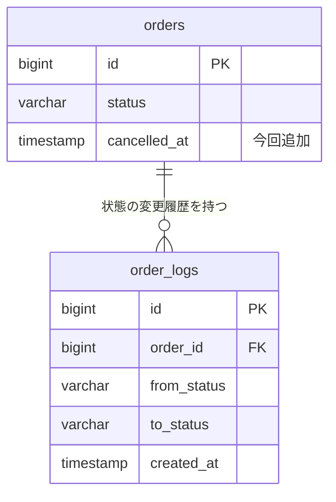

# 詳細仕様書

読み手はオーケストレーター。

DB や API の形を変えるタスクでは、spec.md とは別に**詳細仕様書**をタスクフォルダに作る。
spec.md は「何を達成するか」の合意で、テーブルの列やリクエストのプロパティまで書くと Scope lock が埋もれる。
一方、列名やプロパティ名が合意されないまま実装に入ると、実装エージェントが名前と型を自分で決めることになり、
あとから「その名前ではない」がやり直しになる。

## いつ何を作るか

spec の下書きを書くときに、次の表に当てはまるかを**毎回確かめる**。当てはまったものはすべて作る。

| 変更の内容                                                    | 作るファイル       | 形式                                                             |
| ------------------------------------------------------------- | ------------------ | ---------------------------------------------------------------- |
| DB にテーブルを新規追加する、または大規模な変更がある         | `db-design.md`   | Markdown。**ER 図を mermaid で埋め込む**。列の定義も載せる |
| 上に当たらない DB スキーマの変更（列の追加・変更・削除など）  | `db-design.md`   | Markdown。変更内容の表だけでよい（ER 図は任意）                  |
| API を新規作成する                                            | `openapi.yaml`   | OpenAPI 仕様（API の定義を YAML で書く標準形式）                 |
| 既存 API のインターフェース（リクエスト・レスポンス）を変える | `api-changes.md` | Markdown。変更内容の表                                           |

「大規模な変更」は、**複数のテーブルにまたがる変更**か、**テーブル間の関連（外部キー）が変わる変更**を指す。
迷ったら ER 図を描く。図があって困ることはないが、無いと関連の変更が文章からは読み取りにくい。

どれにも当てはまらなければ、詳細仕様書は作らない。

## 置き場所

**親のタスクフォルダの直下**に置く。分解した場合も、サブタスクのフォルダには置かない。
DB や API の形は複数のサブタスクが参照するため（API を作る側と、それを画面から呼ぶ側など）。

```
.ai/_tasks/受注サマリのキャンセル除外/
├── spec.md
├── db-design.md
├── openapi.yaml
├── progress.json
└── キャンセル済みを金額から除く/
    └── spec.md          ← 「詳細仕様書」の節から ../db-design.md にリンクする
```

作ったファイルは、それを使うタスクの spec.md の「詳細仕様書」の節からリンクする（[spec-template.md](spec-template.md)）。
実装エージェントとレビュアーには `specPath` しか渡さないので、**リンクが無い詳細仕様書は読まれない**。

## 必ず含めること — 変更内容

DB スキーマまたは API のインターフェースを変えるときは、**何がどう変わるかを名前の単位で書く**。
「注文テーブルに状態を持たせる」では足りない。列名・プロパティ名・型・必須かどうかまで書く。

### DB スキーマ（`db-design.md`）

```markdown
## 変更内容

表1: スキーマの変更点

| テーブル | 列 | 変更 | 型 | NULL | 既定値 | 説明 |
|---|---|---|---|---|---|---|
| orders | cancelled_at | 追加 | timestamp | 可 | NULL | キャンセルした日時。未キャンセルなら NULL |
| orders | status | 変更 | varchar(20) → varchar(30) | 不可 | 'new' | 状態の種類が増えるため桁を広げる |
| order_logs | （テーブル） | 追加 | — | — | — | 状態の変更履歴。列は下の「テーブル定義」 |
```

- 新規テーブルは、全列を「テーブル定義」の節に書く（列名・型・NULL・既定値・キー・説明）
- インデックスと制約（一意・外部キー）の追加・変更も同じ表か別表に書く
- 既存データの移行が要るなら、その方針を書く

### ER 図

````markdown
図1: 受注まわりの ER 図（今回追加するのは order_logs）


````

- 図には、変更するテーブルと、それに**直接つながるテーブル**を載せる。DB 全体は描かない
- 今回の追加・変更がどれかを、キャプションか列のコメントで示す

### 新規 API（`openapi.yaml`）

- パス・メソッド・リクエスト（パラメータ・ボディ）・レスポンス（成功と、返しうるエラー）をすべて書く
- プロパティには `type` と `description` を付け、必須のものは `required` をつける
- 対象リポジトリに既存の OpenAPI 定義があれば、そのバージョンと書き方（命名・共通スキーマの置き方）に合わせる。
- ここに書くのは今回追加する API だけ。既存の定義を丸ごと写さない

### 既存 API の変更（`api-changes.md`）

```markdown
## 変更内容

表1: インターフェースの変更点

| API | 場所 | プロパティ | 変更 | 型 | 必須 | 説明 |
|---|---|---|---|---|---|---|
| GET /orders/summary | Response | cancelledCount | 追加 | integer | ○ | キャンセル済みの件数 |
| GET /orders/summary | Request（query） | includeCancelled | 追加 | boolean | — | true のとき金額にキャンセル済みを含める。既定は false |
| POST /orders | Request（body） | note | 変更 | string(100) → string(500) | — | 上限を広げる |
```

- 既存の呼び出し元が壊れる変更（プロパティの削除・改名・必須化・型の変更）は、その旨と影響する呼び出し元を書く
- 新規 API と既存 API の変更が両方あるときは、`openapi.yaml` と `api-changes.md` の両方を作る

## 守ること

- **Markdown の詳細仕様書はテクニカルライティング規約に沿って書く**（SKILL.md の STEP 3 に取り込まれている）。
  図表にはキャプションを付け、本文から参照する
- **詳細仕様書も合意の対象。** spec と一緒に下書きとして書き出し、5-3 でパスを示して合意を取る。
  下書きの間は、Markdown には spec と同じ印を、`openapi.yaml` には先頭にコメント `# 下書き（未合意）` を置き、合意したら外す
- **spec と食い違わせない。** 実行フェーズでユーザーの回答を受けて spec を更新するときは、詳細仕様書も合わせて直す
- 列名・プロパティ名を自分で決めきれないとき（既存の命名規則が読み取れない、など）は、
  未確定の設計判断として `AskUserQuestion` で決めてから書く
